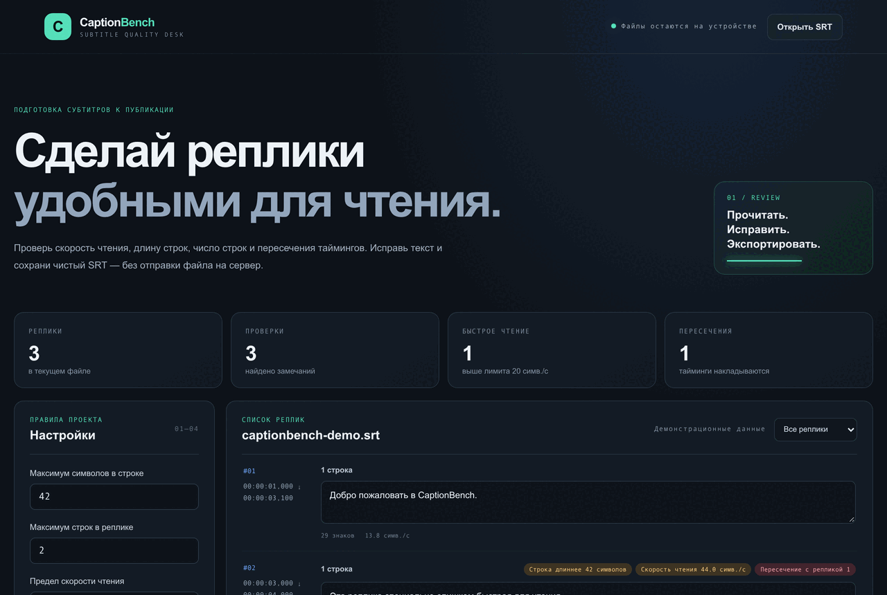

# CaptionBench

Локальный редактор-проверка SRT-субтитров. Находит длинные строки, большое число строк, высокую скорость чтения, пустые реплики и пересечения таймингов. Текст можно исправить прямо в списке и скачать как отдельный SRT.



## Запуск

Нужен Node.js 20+. Установка зависимостей не нужна:

```sh
npm start
```

Открой <http://127.0.0.1:4178>. Можно открыть SRT кнопкой или перетащить файл в список. `Ctrl/Cmd+O` выбирает файл, `Ctrl/Cmd+S` экспортирует проверенную копию.

## Проверки

```sh
npm test
npm run check
```

## Конфиденциальность и ограничения

Файл читается браузером локально и не загружается на сервер. Файлы свыше 25 МБ отклоняются. Поддерживается SubRip (`.srt`), а не WebVTT. Пороговые значения можно менять; замечания о скорости чтения и длине — настраиваемые редакционные ориентиры, а не универсальный стандарт. Инструмент не проверяет перевод, синхронизацию с видео и отображение стилей в конкретном проигрывателе. Изменения не сохраняются автоматически; скачай исправленный файл.

## Лицензия

MIT.
